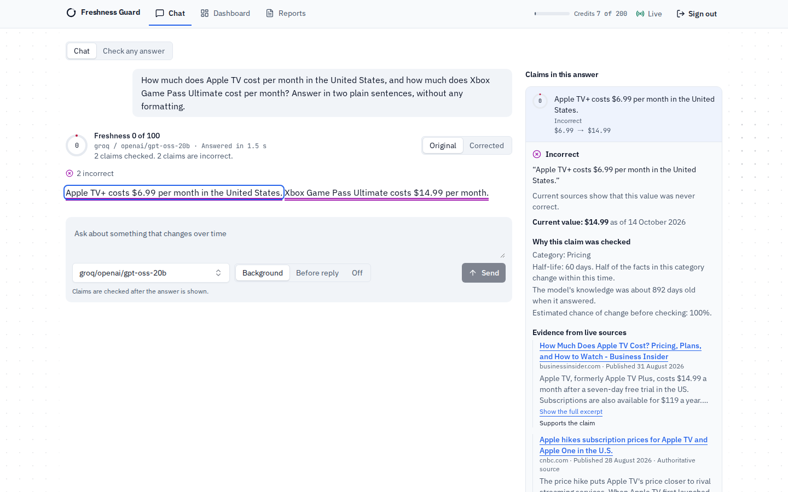
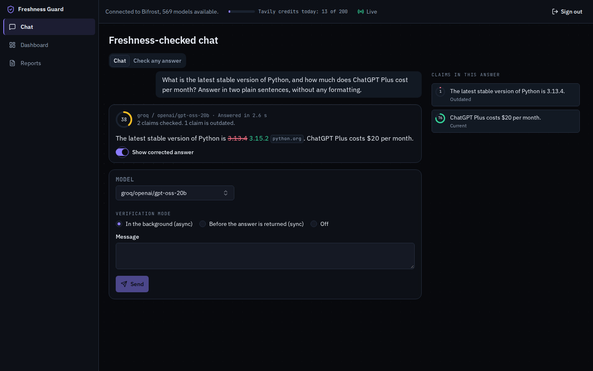
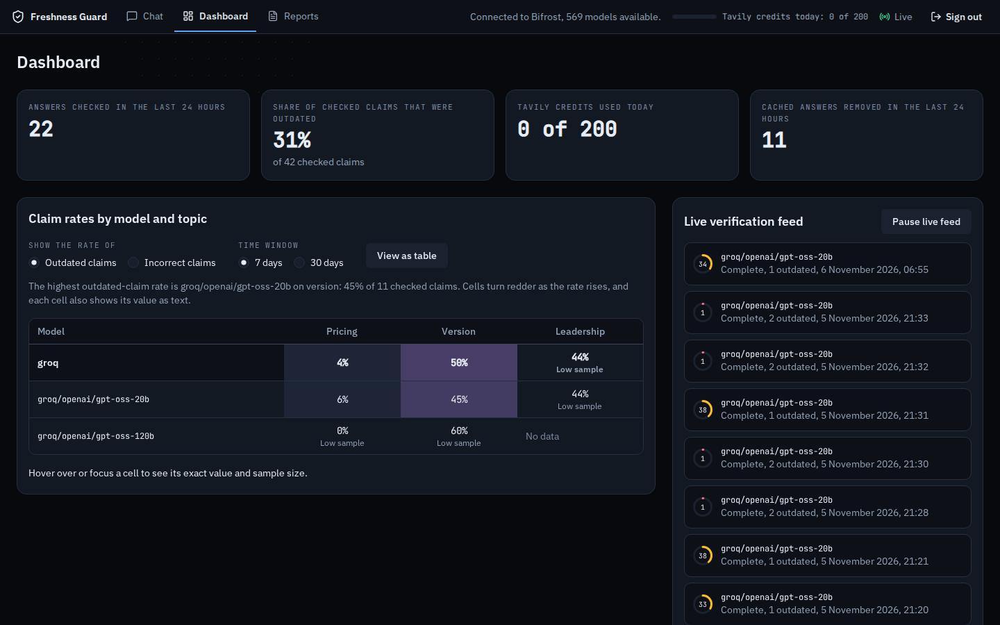

# Freshness Guard

Freshness Guard is a plugin for the open-source [Bifrost](https://github.com/maximhq/bifrost) LLM gateway. It finds the claims in a model's answer that may be outdated, checks them against live web sources with the [Tavily](https://tavily.com) API, scores each claim, and can correct outdated claims before the answer is returned. It ships with a web app for chat, reports and a dashboard, and with an MCP tool that any client of the gateway can call.

It was built for the Global AI Hackathon. The primary problem statement is Bifrost 04, "Build the missing open-source gateway feature". It also covers Tavily problem statement 06, "Build a Stale-Answer Detector for AI Applications".

Live demo and demo video: the links are added here when the project is submitted.



## The problem

A language model answers from what it learned before its training cutoff. Prices, version numbers, laws and office holders change after that, and the model states the old value with the same confidence as a current one. An operator who runs a gateway in front of several models has no place to see this. Every application has to build its own check, or users get confident, outdated answers.

Freshness Guard puts that check in the gateway, where every model and every client passes through it.

## How it meets Bifrost 04

The challenge asks for a real operator problem solved end to end, built on public extension points, with a reproducible integration, tests, documentation and a repository ready for an upstream pull request.

A real operator problem, end to end. An operator adds the plugin to Bifrost's `config.json`. From then on each chat answer gets a freshness report: which claims were checked, which are outdated, what the current value is and where it comes from. The operator chooses per request whether the check runs in the background (`async`), before the answer is returned (`sync`), or not at all (`off`), and whether an outdated answer is annotated, corrected or blocked. Answers in Bifrost's semantic cache that contain an outdated fact are removed from the cache. The dashboard shows how often each model gives outdated claims, by category.

Public extension points. The plugin uses four Bifrost plugin hooks, the `pre_builtin` placement, the semantic cache's metadata and management API, the MCP gateway, and Bifrost's own OpenAI-compatible endpoint for its model calls. [docs/UPSTREAM.md](docs/UPSTREAM.md) lists each one with the file that uses it, and the gaps found along the way.

A reproducible integration with a standard Bifrost installation. The plugin is built as a Go plugin (`.so`) against Bifrost `transports/v2.4.0`. A Go plugin only loads when it is built with the same Go version and the same version of every shared module as the Bifrost binary, and the official Bifrost image is statically linked and cannot load plugins. `deploy/Dockerfile` therefore builds Bifrost from source the way its documentation builds the dynamic binary, builds the plugin with the same toolchain, and runs `deploy/check-shared-versions.sh`, which stops the build when a shared module differs. The quick start below needs Docker and one command after the setup.

Tests, documentation and upstream readiness. The repository has unit, end-to-end and browser tests (see Evaluation), a continuous integration workflow (`.github/workflows/ci.yml`), the Apache License 2.0, and an upstream plan with a readiness checklist in [docs/UPSTREAM.md](docs/UPSTREAM.md). The workflow runs on every push to `main`, and its first run on 6 November 2026 passed.

## How it meets Tavily 06

- Claim identification. A model reads the answer and returns each time-sensitive claim as JSON: the quote, its position in the answer, the entity, the attribute, the value and a category (`pricing`, `version`, `leadership`, `law`, `statistic`, `event`, `feature` or `static`).
- Freshness detection by category. A deterministic triage step estimates how likely a claim is to have changed, from a half-life for its category and the age of the model's knowledge cutoff. Only claims above a risk threshold (0.3 by default) are checked, and claims already verified recently are answered from the plugin's fact cache at no cost.
- Live verification. Each claim gets a Tavily search (basic depth, five results, topic `news` for events and leadership, `general` otherwise). If the judge model finds the evidence insufficient, the plugin runs one advanced search. A daily credit budget (30 by default) stops the plugin from spending more Tavily credits than the operator allows.
- A freshness score per claim. A judge model reads only the retrieved evidence and returns `FRESH`, `STALE`, `WRONG` or `UNVERIFIABLE`, the current value, the date it is known to hold from and a confidence. The score from 0 to 100 combines the verdict with the recency and authority of the sources and how many agree. The answer's score is the average of its claims' scores, weighted by their risk.

## Architecture


| Package | Purpose |
|---|---|
| `plugin` | The Bifrost plugin entry point (`package main`, built with `-buildmode=plugin`). |
| `internal/hooks` | Hook logic, mode and policy selection, response headers. |
| `internal/engine` | Bounded queue, worker pool, daily credit budget. |
| `internal/extract` | Claim extraction and locating each quote in the answer. |
| `internal/triage` | Deterministic risk score from category half-lives and the model's cutoff. |
| `internal/verify` | Tavily evidence, escalation and the judge. |
| `internal/score` | Claim and answer scores. |
| `internal/heal` | Minimal-edit correction and the diff guard. |
| `internal/facts` | Verified facts and the verdict cache. |
| `internal/cachepurge` | Removal of outdated answers from the semantic cache. |
| `internal/llm`, `internal/gateway`, `internal/tavily` | Clients for Bifrost's endpoint, Bifrost's model list and Tavily. |
| `internal/store` | SQLite storage with migrations. |
| `internal/api`, `internal/events`, `internal/mcp`, `internal/webui` | The plugin API, the event stream, the MCP tool and the embedded web app. |
| `internal/bench`, `cmd/freshbench` | The benchmark library and command. |
| `web` | The React web app. It is built and embedded into the plugin with `go:embed`. |

## Quick start

You need Docker (Docker Desktop on Windows) and Git Bash on Windows. Go is not needed on the host, because everything is built in Docker. Go plugins load only on Linux and macOS.

1. Fetch the Bifrost source once: `bash deploy/fetch-bifrost.sh`.
2. Copy `deploy/.env.example` to `deploy/.env` and fill in these variables:
   - `GROQ_API_KEY`, `GEMINI_API_KEY` and `OPENROUTER_API_KEY`: provider keys. The default models use Groq and Gemini, so those two are the ones that matter. All three have free tiers.
   - `TAVILY_API_KEY`: a Tavily key. The free plan is enough to try the plugin.
   - `FG_API_TOKEN`: any long random string. It protects the plugin API and is the sign-in token of the web app. With an empty token the protected routes answer 503.
   - `BIFROST_SETUP_TOKEN`: any long random string. Bifrost reads it too. The plugin uses it to remove outdated answers from the semantic cache.
3. Start Bifrost with the plugin: `docker compose -f deploy/docker-compose.yml up -d --build bifrost`.
4. Open http://localhost:8090/freshness/ui/ and sign in with `FG_API_TOKEN`. The gateway is at http://localhost:8080. The health check is http://localhost:8090/freshness/health.

On Windows, set `MSYS_NO_PATHCONV=1` in Git Bash before `docker compose run` commands that pass paths such as `/src/...`.

To run the tests, which also build in Docker:

```bash
docker compose -f deploy/docker-compose.yml run --rm gotest
docker compose -f deploy/docker-compose.yml --profile tools up -d --build bifrost-e2e
docker compose -f deploy/docker-compose.yml run --rm e2e
docker compose -f deploy/docker-compose.yml run --rm webtest
npm --prefix web test
```

## Using it

Request headers on any chat request to Bifrost:

| Header | Values | Meaning |
|---|---|---|
| `x-bf-freshness` | `async`, `sync`, `off` | When the check runs. The default is `async`. |
| `x-bf-freshness-policy` | `annotate`, `heal`, `block` | What sync mode does with an outdated answer: leave the body unchanged, correct the outdated claims, or return an error with the report ID. The default is `heal`. |

If a sync check takes longer than `sync_timeout_ms` (8 seconds by default), the original answer is returned with `X-Freshness-Status: pending` and the check finishes in the background. Responses carry `X-Freshness-Status`, `X-Freshness-Report-Id`, `X-Freshness-Score`, `X-Freshness-Stale`, `X-Freshness-Checked` and `X-Freshness-Healed`.

Plugin API, on port 8090 under `/freshness`. Every route except `/freshness/health` and the static web files needs `Authorization: Bearer $FG_API_TOKEN`.

| Route | Purpose |
|---|---|
| `POST /check` | Check any text. |
| `GET /reports`, `GET /reports/{id}` | List reports and read one with its claims, evidence and scores. |
| `GET /events` | Server-sent events with report progress. |
| `POST /chat`, `GET /models` | Chat through Bifrost with a chosen model, mode and policy, and list the models Bifrost offers. |
| `GET /leaderboard?window=7d\|30d`, `GET /summary` | Dashboard data. |
| `GET /status` | Gateway reachability, today's Tavily credits and the default settings. |
| `GET /health` | Health check. |
| `/mcp` | The MCP tool, below. |

The web app has three parts. Chat sends a question to a model of your choice and underlines each claim as its verdict arrives. A claim opens an explanation with the evidence and the judge's reasoning, and a switch shows the corrected answer. Check any answer takes pasted text. The dashboard shows how often each model gives outdated or incorrect claims, by category, with a live feed of checks.





MCP tool. The plugin serves a `check_freshness` tool that takes a text and returns the score and a verdict for each claim. Through Bifrost's MCP gateway, Bifrost lists it as `freshness_guard-check_freshness`:

```bash
claude mcp add --transport http freshness-guard http://localhost:8080/mcp
```

The plugin also serves the tool directly at `http://localhost:8090/freshness/mcp`, with the token in an `Authorization: Bearer` or `X-Freshness-Token` header. Bifrost's MCP client entry for the plugin is in `deploy/config.json`. It sets `disable_auto_tool_inject: true`, because otherwise Bifrost adds the tool to every chat request, including the plugin's own model calls.

## Configuration

The plugin is configured under `plugins` in Bifrost's `config.json`, as in `deploy/config.json`. A value of the form `env.NAME` is read from the environment variable `NAME`. Invalid values are reported in the log and replaced by the default.

| Setting | Default | Meaning |
|---|---|---|
| `tavily_api_key` | none | Tavily key, usually `env.TAVILY_API_KEY`. |
| `default_mode` | `async` | `async`, `sync` or `off`. |
| `default_policy` | `heal` | `annotate`, `heal` or `block`. |
| `sync_timeout_ms` | `8000` | How long sync mode waits (1000 to 60000). |
| `block_confidence` | `0.7` | Judge confidence needed for `block`. |
| `fail_closed` | `false` | In `block` mode, return an error when a check fails. |
| `models.extract`, `models.judge`, `models.heal` | `groq/openai/gpt-oss-20b`, `groq/openai/gpt-oss-120b`, `groq/openai/gpt-oss-120b` | Models for each role, in Bifrost's `provider/model` form. |
| `fallbacks.extract`, `fallbacks.judge`, `fallbacks.heal` | `gemini/gemini-3.5-flash-lite`, `gemini/gemini-3.5-flash`, `gemini/gemini-3.5-flash` | Fallback models. |
| `model_cutoffs` | none | Knowledge cutoff of a model, as `YYYY-MM`. |
| `risk_threshold` | `0.3` | Claims below this chance of having changed are not checked. |
| `max_claims` | `12` | Claims checked per answer (1 to 50). |
| `workers`, `queue_size` | `4`, `256` | Worker pool and queue size. |
| `daily_credit_budget` | `30` | Tavily credits per UTC day. |
| `cache_purge.enabled`, `cache_purge.setup_token` | `true`, none | Remove outdated answers from the semantic cache. |
| `chat_cache_key` | none | Cache key for the web app's chat requests. |
| `virtual_keys` | none | Per virtual key mode, policy and sample rate. |
| `api.host`, `api.port`, `api.token` | `0.0.0.0`, `8090`, none | The plugin API. |
| `db_path` | `/app/data/freshness.db` | The SQLite database. |

The plugin entry must use `"placement": "pre_builtin"`, so that its hooks also see answers that the semantic cache serves.

## Evaluation

All numbers below come from files in `bench/results/`. The set and the way its labels were made are described in [bench/README.md](bench/README.md). Targets are written as targets. They are not results.

Curated set. 51 claims (27 outdated, 24 current), labelled on 6 November 2026 from official sources. Claude Code proposed the labels and the developer has not yet reviewed them. A text counts as predicted outdated when one of its checked claims is `STALE` or `WRONG`. The run (`curated-2026-11-05-2`) used `groq/openai/gpt-oss-20b` to extract and `groq/openai/gpt-oss-120b` to judge, on a fresh stack with no cached verdicts.

| Measure | Value |
|---|---|
| Items, errors | 51, 0 |
| Precision, recall, F1 | 0.96, 0.96, 0.96 |
| True positives, false positives, false negatives, true negatives | 26, 1, 1, 23 |
| Outdated items where the reported current value matched the label | 23 of 26 |
| Tavily credits | 53 (1.04 per item) |
| Latency, median and 95th percentile | 4196 ms, 6856 ms |

| Category | TP | FP | FN | TN |
|---|---|---|---|---|
| pricing | 8 | 0 | 0 | 6 |
| version | 7 | 1 | 1 | 5 |
| leadership | 7 | 0 | 0 | 9 |
| law | 3 | 0 | 0 | 3 |
| feature | 1 | 0 | 0 | 0 |

The one false positive is "The latest stable release of Go is Go 1.27": the judge saw that Go 1.27.3 was out and called the claim outdated. The text does not say whether it means a release series or a patch release, so the label was kept. The one false negative is "The latest Django release series is Django 6.0": the judge relied on a cached copy of the Django download page that lists older releases. An earlier run of the same set (`curated-2026-11-05`) had 40 errors of 51, because two checks at once exceeded Groq's free-tier limit of 8000 tokens per minute. The file is kept as a record. The rerun spaced the checks 30 seconds apart. The set is small and its facts were chosen by the same developer and tool that built the plugin, so these numbers say little about accuracy on other texts.

Async overhead. `bench/results/overhead-2026-11-05` sent 1000 chat requests, one at a time and alternating, to a Bifrost with the plugin and a fake provider on a Windows 11 machine running Docker Desktop. The baseline is `x-bf-freshness: off`.

| Mode | Requests | p50 | p95 | p99 |
|---|---|---|---|---|
| off | 500 | 1.015 ms | 1.694 ms | 3.778 ms |
| async | 500 | 1.010 ms | 1.660 ms | 3.496 ms |

Async minus off was -0.005 ms at p50 and -0.282 ms at p99. A negative difference is noise, and the result shows that the plugin's added time is too small to measure on this setup.

Targets from the design specification, next to what was measured:

| Target | Measured |
|---|---|
| Async mode adds less than 2 ms at the 99th percentile. | Added time was within measurement noise (-0.282 ms at p99, see above). |
| Sync mode adds at most 6 seconds at the median for answers with five or fewer checked claims. | Not measured on a sync run. The curated run's median report latency was 4.2 s for single-claim texts, which is about how long a sync request waits. |
| Precision of at least 0.8 on the curated set. | 0.96 on the run above. |
| Triage cuts Tavily calls by at least 50% with at most 10% lost recall. | Not measured. With no model given, every claim has a chance of change of at least 0.5, so this set cannot show savings. |

Not measured: FreshQA, and ablations of triage and of fresh-context injection.

Tests, run on 6 November 2026:

| Suite | Result |
|---|---|
| Go unit tests (`go test ./...` in Docker) | 345 tests pass |
| End-to-end tests against Bifrost with the plugin and fake providers | 20 of 20 pass |
| Web unit tests (Vitest) | 180 of 180 pass |
| Browser tests with an accessibility scan (Playwright and axe) | 7 of 7 pass |

To reproduce the curated run, follow [bench/README.md](bench/README.md). The overhead run is `freshbench overhead` against the end-to-end stack.

## Limitations

- The answer text in the chat shows Markdown as typed. A claim inside Markdown emphasis may not be located in the answer, so it is listed beside the answer but not underlined in it.
- The judge decides from the search results it is given. A stale source can produce a wrong verdict, as in the Django case above. The plugin reuses recently verified facts, so one wrong fact can repeat until it expires.
- Free-tier model keys have tight limits. Groq's free tier allows 8000 tokens per minute for the default models, so many checks at once return rate-limit errors. In the first benchmark run the configured Gemini fallbacks did not take over, and the cause is not yet known.
- Sync mode waits at most `sync_timeout_ms`. The median check took 4.2 s and the 95th percentile 6.9 s in the curated run, so slow checks come close to the default limit of 8 s.
- Removing outdated answers from the semantic cache works with the Bifrost setup token. Bifrost admin credentials are not supported.
- Not built: the canary watchlist, the knowledge cutoff detector with its probes, fresh-context injection, a Prometheus metrics endpoint, and a table of measured half-lives.
- Bifrost's `HTTPTransportStreamChunkHook` is not used. Streamed answers are checked after the last chunk.

## AI usage and licence

Models are used inside the product for claim extraction, judging and correcting, and Claude Code was used to build the project. [docs/AI_USAGE.md](docs/AI_USAGE.md) describes both, the safeguards, and what data leaves the machine.

Freshness Guard is licensed under the Apache License 2.0, except for three components copied from React Bits in `web/src/components/reactbits/`, which are under MIT + Commons Clause (see [web/public/react-bits-license.md](web/public/react-bits-license.md)). See [LICENSE](LICENSE) and [NOTICE](NOTICE).
